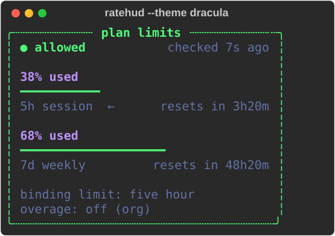
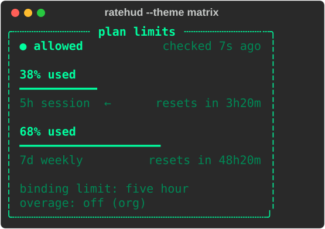

A small terminal tool that shows how close you are to your Claude subscription's
usage limits (the 5 hour session limit and the 7 day weekly limit), live, in a
panel meant to sit in a terminal split while you work with Claude Code.

It is cross platform (Linux, macOS, Windows) and only has one dependency: `rich`.

<p>
  
  
</p>

## What it shows

- Overall status (allowed or rejected)
- 5h session usage, as a percentage, with a progress bar and the time until it resets
- 7d weekly usage, same format
- Which of the two limits is currently the binding one (the one that will stop you first)
- Whether overage billing is enabled or disabled for your account, and why

## How it works

Claude Code receives your plan's usage percentages as HTTP response headers on
every API request it makes, but it never writes them to disk. There is no local
file to read them from.

This tool works around that by reading the OAuth access token already saved by
Claude Code at `~/.claude/.credentials.json`, and making a minimal API request of
its own (1 output token, effectively free) just to read the rate limit headers
back from the response. It does this once at startup and then on a timer
(every 60 seconds by default).

The token is read from disk by the script itself and is never printed, logged,
or sent anywhere other than `api.anthropic.com`.

## Requirements

- Python 3.10 or newer
- A Claude Code login (the tool reads the same credentials file Claude Code uses)
- The `rich` package

## Installation

### Option A: as a global command (recommended)

This installs `ratehud` as a standalone command on your PATH, runnable from
any directory, using [pipx](https://pipx.pypa.io/).

#### Installing pipx

**Linux (Arch)**

```
sudo pacman -S python-pipx
pipx ensurepath
```

**Linux (Debian / Ubuntu)**

```
sudo apt install pipx
pipx ensurepath
```

**Linux (any other distribution) / macOS**

```
python3 -m pip install --user pipx
python3 -m pipx ensurepath
```

**Windows (PowerShell)**

Requires Python installed from [python.org](https://www.python.org/downloads/)
or the Microsoft Store.

```
py -m pip install --user pipx
py -m pipx ensurepath
```

On macOS, `brew install pipx` works too if you use Homebrew.

After installing pipx, close and reopen your terminal (`ensurepath` adds a
directory to your PATH that only takes effect in new terminal sessions).

#### Installing ratehud

```
pipx install git+https://github.com/Achille1912/ratehud.git
```

Same command on Windows, once pipx is installed.

To upgrade later:

```
pipx upgrade ratehud
```

If that doesn't pick up a new commit (pipx occasionally doesn't notice
updates to the same git branch), force it:

```
pipx reinstall ratehud
```

Plain `pip` works too, if you'd rather manage the PATH yourself:

```
pip install --user git+https://github.com/Achille1912/ratehud.git
```

### Option B: from source (for development)

```
git clone https://github.com/Achille1912/ratehud.git
cd ratehud
python3 -m venv .venv            # on Windows: python -m venv .venv
.venv/bin/pip install -e .       # on Windows: .venv\Scripts\pip install -e .
```

## Usage

If installed via Option A, just run:

```
ratehud
```

from anywhere. If running from source (Option B):

```
.venv/bin/python ratehud.py      # on Windows: .venv\Scripts\python ratehud.py
```

Leave it running in a split pane. It redraws itself in place, it does not
scroll your terminal. Stop it with Ctrl+C.

### Options

| Flag | Default | Description |
|---|---|---|
| `--theme` | `dracula` | Color theme. One of `dracula`, `nord`, `matrix`, `mono`. |
| `--limit-interval` | `60` | Seconds between checks of the usage limits. Each check is one small live API call. |

Example:

```
ratehud --theme matrix --limit-interval 120
```

## Notes and limitations

- This tool makes a real, small API call on a timer using your own credentials.
  It is not free in the strictest sense: it consumes a tiny, generally
  negligible amount of your 5h/7d quota every time it checks.
- If your OAuth token has expired, the panel will tell you to run `claude` once
  to refresh it, rather than crashing.
- If no Claude Code credentials file is found, the panel shows an error instead
  of usage data.
- The usage limit header names used here are not part of Anthropic's public,
  documented API. They were discovered by inspecting real response headers and
  could change without notice.

## License

MIT

## Note

This repository was built with the help of AI tools.
